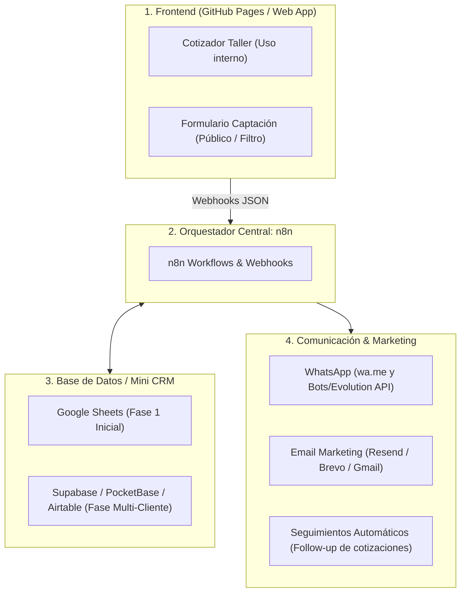

# AGN-JOB — Arquitectura Escalable: Cotizador + Mini CRM + Automatizaciones

## 1. Visión del Ecosistema AGN-JOB

El Cotizador no es solo una calculadora: es la **puerta de entrada (Lead Magnet y herramienta operativa)** de un **Mini CRM y sistema de ventas para pymes/talleres** en Uruguay y la región.

---

## 2. Cómo se integra el Mini CRM y el Email Marketing con tu stack (n8n + GitHub)

### A. Captura Automática de Contactos (Lead Generation)
Cada vez que:
1. Un cliente completa el formulario de cotización.
2. O el carpintero cotiza una abertura en su modo taller e ingresa el nombre y teléfono del cliente:
* El frontend dispara un **Webhook a n8n**.
* n8n toma los datos: Nombre, Teléfono, Email (si aplica), Localidad, Detalle de la abertura y Monto cotizado.
* Se guarda automáticamente en la base de datos de contactos.

### B. Funciones del Mini CRM integradas con n8n
* **Estado de la oportunidad (Pipeline simple):**
  * `Cotizado` ➔ `En seguimiento` ➔ `Aprobado / Seña pagada` ➔ `En fabricación` ➔ `Entregado`.
* **Historial de presupuestos por cliente:**
  * Si el cliente vuelve a consultar 3 meses después, el taller sabe qué se le presupuestó antes.
* **Alertas automáticas de seguimiento (Follow-up):**
  * n8n revisa cotizaciones con más de 48 horas sin respuesta y le recuerda al carpintero o le manda un mensaje al cliente: *"Hola [Nombre], ¿pudiste ver el presupuesto de las aberturas? Avisanos si querés coordinar medidas en obra."*

### C. Email Marketing y Reactivación de Clientes
* Conectando **n8n con un proveedor de email transaccional gratuito/accesible** (como Resend, Brevo o MailerLite):
  * **Envío formal del PDF/Presupuesto:** El cliente recibe un correo prolijo con el membrete de la carpintería.
  * **Campañas estacionales:** Avisos a la base de datos (ej. *"Llega el invierno: cambiá tus ventanas a DVH con 15% de descuento en mano de obra"*).

---

## 3. Estrategia Multi-Cliente (Para escalarlo a más carpinterías con AGN-JOB)

Para ofrecer esto como un servicio a múltiples clientes bajo **AGN-JOB**:

1. **Multi-Tenant simple (Identificador de Cliente / Taller):**
   * Cada carpintería tiene su `client_id` (ej. `?taller=aluminio-maldonado` o un subdominio/carpeta).
   * La app carga automáticamente el logo del taller, sus teléfonos de contacto y su lista de precios propia.
2. **Modelo de Negocio para AGN:**
   * **Setup inicial:** Cobro por configuración del cotizador con sus precios + diseño de marca.
   * **Abono mensual (SaaS / Mantenimiento):** Por tener la web activa, el guardado de contactos, los seguimientos automáticos y el soporte.
